 
 

 

# 📬 Awesome Email Marketing & Newsletter Automation 🚀

> 🌟 A curated directory of top-tier **email marketing platforms**, **newsletter automation tools**, and **self-hosted open-source email solutions**. Discover the best SaaS platforms and open-source software for high-deliverability campaign sending, subscriber segmentation, drip sequence automation, and privacy-first self-hosted mailing lists.

📅 **Last updated: March 2026**

This repository tracks notable **SaaS platforms** and **open-source GitHub projects** across the global **Email Marketing & Newsletter Automation** ecosystem. These tools empower creators, digital agencies, e-commerce stores, developers, and enterprise organizations to build subscriber lists, launch targeted broadcast campaigns, and automate complex behavioral journeys—ranging from lightweight creator-first newsletter platforms to full-scale customer journey builders.

---

## 📑 Table of Contents
- [📈 Sector Overview & Market Dynamics](#-sector-overview--market-dynamics)
- [☁️ SaaS & Hosted Platforms](#️-saas--hosted-platforms)
- [💻 Open-Source GitHub Projects](#-open-source-github-projects)
- [⚖️ Key Architectural & Implementation Trade-Offs](#️-key-architectural--implementation-trade-offs)
- [🤝 How to Contribute](#-how-to-contribute)
- [💖 Support & Community](#-support--community)
- [⭐ Star History](#-star-history)
- [🛡️ Disclaimer & Best Practices](#️-disclaimer--best-practices)

---

## 📈 Sector Overview & Market Dynamics

The global email marketing and automation software market is currently valued at approximately **$13.4B – $14.0B** and is projected to expand past **$25B – $30B+ by the early 2030s** at an estimated CAGR of **10.8% to 15%**, driven by high ROI (~$36 return per $1 spent), first-party data imperatives amidst third-party cookie deprecation, and AI-driven personalization.

The sector is **moderately fragmented** rather than a winner-take-all monopoly: while enterprise and private-equity giants (such as Mailchimp/Intuit, Klaviyo, and ActiveCampaign) command significant aggregate market share in SMB and e-commerce segments, a massive long tail of specialized ESPs, creator-centric newsletters (e.g., Kit), localized European privacy-first services (e.g., Brevo), and self-hosted open-source software (e.g., Listmonk, Mautic) thrives by catering to vertical-specific workflows, compliance demands (GDPR/HIPAA), and avoiding punishing per-subscriber list pricing.

---

## ☁️ SaaS & Hosted Platforms

A breakdown of top hosted commercial platforms, ranked in descending order by enterprise scale (valuation / annual revenue).

| Product | 🏢 Enterprise Scale (Valuation / Revenue) | 📝 Description | 💰 Pricing (Starting Tier) | 🎁 Free Tier & Trial Limits |
|:---|:---|:---|:---|:---|
| **[Mailchimp](https://mailchimp.com/)** | **~$12B Valuation** (Acquired by Intuit for $12B; ~$800M–$1B ARR) | Industry-standard email marketing and automation platform with predictive audience segmentation, visual customer journeys, and transactional sending. | **$13.00/month** (Essentials tier, up to 500 contacts / 5,000 sends) | **Free forever plan**: Up to 500 contacts, 1,000 sends/month, pre-built templates, 1 audience, and basic 4-step automations; **14-day free trial** for paid tiers. |
| **[Klaviyo](https://www.klaviyo.com/)** | **~$10B–$11B Market Cap** (NYSE: KVYO; ~$1.23B FY2025 Revenue) | Premier e-commerce retention and marketing automation engine featuring deep Shopify/WooCommerce syncing, predictive lifetime value analytics, and multi-channel SMS/push flows. | **$20.00/month** (Email plan, up to 500 profiles / 5,000 monthly sends) | **Free forever plan**: Up to 250 profiles, 500 email sends/month, 150 free SMS/MMS credits, and 60 days of built-in email support. |
| **[ActiveCampaign](https://www.activecampaign.com/)** | **~$3B Valuation** (Series C; ~$200M–$250M+ ARR) | Advanced automation-first platform providing conditional journey branching, built-in sales CRM pipelines, lead scoring, and predictive win probabilities. | **$15.00/month** (Starter tier billed annually, up to 1,000 contacts; or $19/mo monthly) | **14-day free trial**: Up to 100 contacts and 100 total email sends, 1 user seat, full access to Pro/automation features (no credit card required; no permanent free plan). |
| **[Brevo](https://www.brevo.com/)** | **~$1B+ Valuation** (Unicorn status; >€200M / ~$218M+ ARR) | Cost-effective multi-channel customer platform combining bulk email campaigns, SMS/WhatsApp marketing, visual automation funnels, and shared team inbox. | **$9.00/month** (Starter tier for 5,000 emails/month with unlimited contacts; no daily send ceiling) | **Free forever plan**: Unlimited contacts stored, 300 email sends/day (9,000 emails/month), mobile-friendly email designer, and automation workflows capped at 2,000 unique contacts. |
| **[Constant Contact](https://www.constantcontact.com/)** | **~$120M–$150M+ ARR** (Clearlake Capital PE portfolio) | SMB-oriented marketing suite featuring beginner-friendly newsletter builders, social media campaign scheduling, event registration tools, and autoresponder sequences. | **$12.00/month** (Lite tier, up to 500 contacts with 1 user seat and automated welcome emails) | **30-day free trial** (14 days in select regions): Up to 100 total email sends across unlimited uploaded contacts for testing (no credit card required; no permanent free plan). |
| **[GetResponse](https://www.getresponse.com/)** | **~$150M ARR** (Bootstrapped & privately held) | Comprehensive inbound marketing hub featuring email marketing, marketing automation, AI campaign generation, webinars, and landing page funnels. | **$19.00/month** (Starter tier, up to 1,000 contacts with unlimited monthly sends; or $15.58/mo billed annually) | **Free forever plan**: Up to 500 contacts, 2,500 newsletter sends/month, 1 landing page/website builder, and signup forms; plus **14-day trial** of premium features. |
| **[Campaign Monitor](https://www.campaignmonitor.com/)** | **~$600M Valuation** (Historic Series A benchmark; ~$80M–$150M ARR under Marigold) | High-design email platform tailored for agencies, marketing teams, and publishing brands with pixel-perfect drag-and-drop templates and transactional email APIs. | **$11.00/month** (Lite tier, up to 500 contacts / 2,500 sends/month; $47/month at 1,000 contacts) | **Free trial**: Test campaign creation and send full preview campaigns to up to 5 individual subscriber addresses (no credit card required; no permanent free plan). |
| **[Kit (ConvertKit)](https://convertkit.com/)** | **~$43M–$45M ARR** (Bootstrapped creator economy leader) | Creator-first audience platform focused on high-deliverability broadcast newsletters, paid subscription communities, dynamic subscriber tagging, and digital product sales. | **$39.00/month** (Creator plan, up to 1,000 subscribers with visual automations and third-party integrations; or $29/mo annually) | **Free forever plan**: Up to 10,000 subscribers, unlimited email sends, unlimited forms/landing pages, basic segmentation, and 1 active automation journey (Kit branding included). |
| **[MailerLite](https://www.mailerlite.com/)** | **~$90M+ Acquisition Valuation** (€84M Vercom acquisition; ~$18M–$25M ARR) | Clean, intuitive email automation and newsletter platform featuring landing page builders, paid newsletter subscriptions, and interactive dynamic blocks. | **$12.00/month** (Comfort plan, up to 500 subscribers / 5,000 sends/month; or $10.80/mo billed annually) | **Free forever plan**: Up to 250 subscribers, 2,500 email sends/month, 3 active automations, 10 forms/landing pages, and email support; **30-day free trial** of premium Power features. |

---

## 💻 Open-Source GitHub Projects

Self-hosted email marketing platforms and newsletter managers allow organizations to achieve complete data sovereignty, customize compliance boundaries (GDPR, HIPAA), and eliminate per-subscriber subscription penalties.

The projects below are **sorted in descending order by GitHub stargazers count**. Click any Stars_Badge to inspect real-time repository stars.

| Project | ⭐ GitHub_Stars | ⚙️ Tech Stack / Architecture | 💡 Core Capabilities & Differentiators | 🎯 Best Suited For |
|:---|:---|:---|:---|:---|
| **[Listmonk](https://github.com/knadh/listmonk)** |  | Go, PostgreSQL, Vue.js | Single-binary deployment with negligible memory consumption. Sends millions of messages at high throughput via multiple custom SMTP relays or Amazon SES. Provides SQL-level segmentation queries, analytics, and an HTTP/REST API. | Developers needing a high-speed, lightweight newsletter manager and transactional mailing engine. |
| **[BillionMail](https://github.com/Billionmail/BillionMail)** |  | Docker, Go/Node.js, Mailserver stack | All-in-one open-source mail server and email marketing solution. Combines full inbound/outbound mail transfer agent (MTA) server deployment with a modern campaign delivery and newsletter dashboard. | Teams wanting a turnkey self-hosted infrastructure bundling the underlying mail server with campaign tools. |
| **[Mautic](https://github.com/mautic/mautic)** |  | PHP (Symfony), MySQL, Composer | The most comprehensive open-source marketing automation platform available. Full visual multi-channel workflow builder, behavioral lead scoring, dynamic web content personalization, and deep CRM integration. | Growth marketers and agencies requiring enterprise HubSpot-style automation journeys without subscription fees. |
| **[Mailtrain](https://github.com/Mailtrain-org/mailtrain)** |  | Node.js, MySQL/MariaDB, Redis | Established self-hosted newsletter manager built on Nodemailer. Handles million-subscriber lists with multi-core queue processing, custom field filtering, click/open tracking, GPG encryption support, and list-based autoresponders. | Organizations managing large static subscription lists seeking proven Node.js self-hosted software. |
| **[Plunk](https://github.com/useplunk/plunk)** |  | TypeScript, Node.js, Next.js, AWS SES | Modern developer-first email platform that bridges marketing campaigns with product transactional emails. Features a headless email API, event triggers, modular contact management, and clean user experience. | Full-stack developers wanting an open-source SendGrid/Resend alternative for transactional and marketing emails. |
| **[Notifuse](https://github.com/Notifuse/notifuse)** |  | Go, TypeScript, PostgreSQL | Open-source multi-tenant transactional and newsletter platform. Built with a visual MJML drag-and-drop template designer, Liquid templating support, and native adapters for 7+ SMTP/API sending relays. | Teams seeking high design fidelity via MJML with flexible multi-provider failover. |
| **[Keila](https://github.com/pentacent/keila)** |  | Elixir (Phoenix), PostgreSQL, TailwindCSS | Privacy-by-design European newsletter tool with a clean, responsive UX. Avoids tracking cookies, supports double opt-in, features block/markdown editors, and routes through Amazon SES, SendGrid, Mailgun, Postmark, or custom SMTP. | European organizations and privacy-conscious operators requiring strict GDPR compliance and modern UI. |
| **[SendPortal](https://github.com/mettle/sendportal)** |  | PHP (Laravel), MySQL/PostgreSQL | Polished self-hosted email marketing and newsletter platform. Offers workspace management, contact segment tag filters, raw HTML/WYSIWYG campaign editors, unsubscribe handling, and seamless integrations with Postmark, SES, and SendGrid. | Laravel developers and digital agencies seeking a customizable, self-hosted white-label newsletter backend. |
| **[phpList](https://github.com/phpList/phplist3)** |  | PHP, MariaDB/MySQL | Battle-tested open-source newsletter management software with continuous community development since 2000. Features bounce handling, scheduled autoresponders, low memory footprint, and extensive plugin architecture. | Community groups, universities, and non-profits seeking stable, lightweight mailing list software. |
| **[Helio](https://github.com/achref-soua/helio)** |  | TypeScript, Python, PostgreSQL, Temporal | Next-generation AI-native marketing platform featuring visual React Flow customer journey maps executed as durable Temporal workflows. Includes AI copilot assistance and Model Context Protocol (MCP) server support for AI agents. | Engineering teams building automated, durable lifecycle journeys with AI-assisted drafting and orchestration. |
| **[NetSendo](https://github.com/NetSendo/NetSendo)** |  | PHP (Laravel), Vue.js, Docker, WebSockets | All-in-one marketing suite bundling email automation, SMS campaign sequences, lead management CRM pipelines, live website visitor tracking, and OpenAI/Claude/Gemini AI integrations. | Businesses looking for an integrated self-hosted alternative covering email marketing, SMS, and basic CRM. |

---

## ⚖️ Key Architectural & Implementation Trade-Offs

When selecting between commercial SaaS providers and self-hosted open-source software, teams face critical structural trade-offs:

1. **💸 Total Cost of Ownership vs. Scaling Penalties:**
   - **SaaS ESPs** charge aggressively by subscriber contact tiers or profile counts. A creator or company scaling from 5,000 to 100,000 contacts often faces costs leaping from $40/month to over $700–$1,200/month on platforms like Klaviyo or ActiveCampaign.
   - **Self-Hosted Open-Source** decoupled tools (such as Listmonk or Keila) run on a modest $10–$20/month VPS paired with high-volume SMTP relays (e.g., Amazon SES at $0.10 per 1,000 emails), allowing you to store 500,000+ subscribers and send millions of messages at a fraction of the cost.

2. **📬 Deliverability & Infrastructure Maintenance:**
   - Commercial SaaS services manage shared IP pools, automated feedback loops, bounce suppression lists, and ISP relations behind the scenes.
   - Self-hosted operations require engineering diligence to implement SPF, DKIM, DMARC, reverse DNS (rDNS), list hygiene, and IP warm-up routines. Deliverability configuration errors can harm custom sender domains without proper monitoring.

3. **🔄 Automation Depth vs. Simplicity:**
   - Visual drag-and-drop journey builders with conditional branching, lead scoring, and webhooks are native to enterprise platforms like ActiveCampaign, Mautic, and Helio.
   - Pure newsletter senders like Listmonk or Keila prioritize throughput and simplicity, delegating automated drip sequences to scheduled cron jobs or external API integrations.

---

## 🤝 How to Contribute

We welcome additions, updates, and corrections from the community! 🙌

1. 🍴 Fork this repository.
2. 🌿 Create a new branch: `git checkout -b update/add-tool-name`.
3. 📝 Modify `README.md` keeping the established table formats:
   - For **SaaS**: Include product name, estimated enterprise scale/valuation, exact starting tier pricing, and explicit free tier / free trial limits.
   - For **Open-Source**: Include repository name, Stars_Badge linked to stargazers (`style=social&color=white`), architecture stack, core features, and best target persona. Ensure the table maintains descending order by GitHub_Stars.
4. 🚀 Open a Pull Request detailing the changes and citing official documentation or financial references.

---

## 💖 Support & Community

If you found this directory helpful or use it to choose your marketing stack, please consider supporting the project:

- ⭐ **Star this repository** to help others discover it on GitHub.
- 🍴 **Fork and share** with colleagues, growth hackers, and dev communities.
- 💬 **Join the discussion** in our [Discord Community](https://discord.gg/jc4xtF58Ve) to discuss newsletter strategies and deliverability setups.
- ☕ **Buy me a coffee / Become a sponsor**: If this resource saved your team time or infrastructure costs, consider backing continued maintenance via the [GitHub Sponsors Dashboard](https://github.com/sponsors/ishandutta2007).

Thank you for being part of this community! ✨

---

##  Star History

---

## 🛡️ Disclaimer & Best Practices

- **🔍 Independent Community Resource:** This repository is an open community-curated educational project and does not constitute a commercial endorsement.
- **📜 Compliance Regulations:** Senders are strictly responsible for adhering to international anti-spam legislation, including the US CAN-SPAM Act, European GDPR, and Canadian CASL (such as enforcing verifiable double opt-in, clear sender identification, and one-click RFC 8058 unsubscribe headers).
- **🏷️ Pricing Dynamics:** SaaS pricing tiers, feature gates, and free trial allowances are subject to vendor modifications. Always verify pricing details on official platform sites prior to migration.
